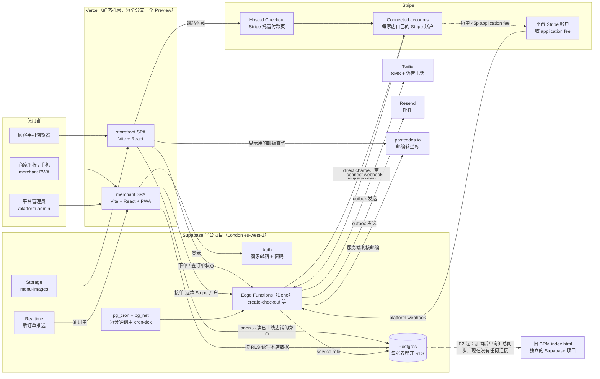
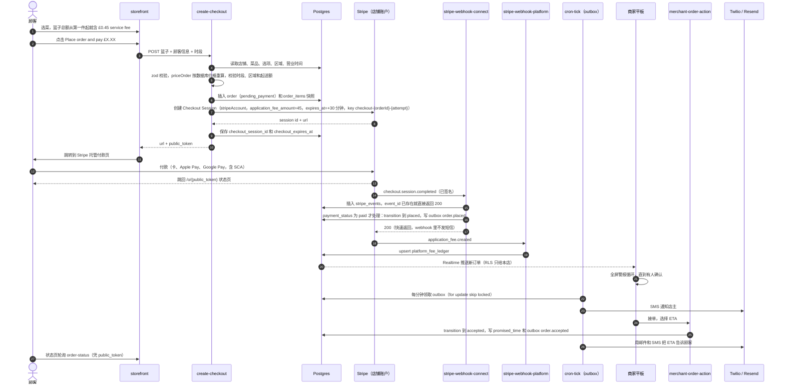
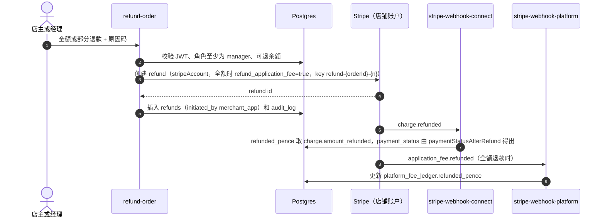
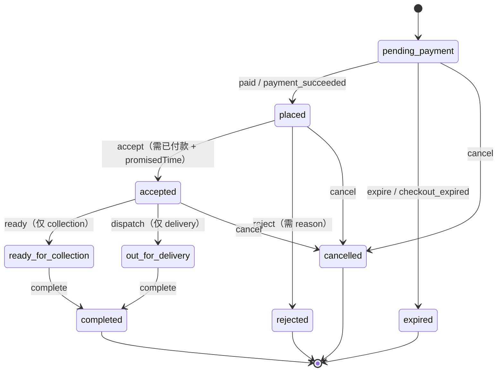
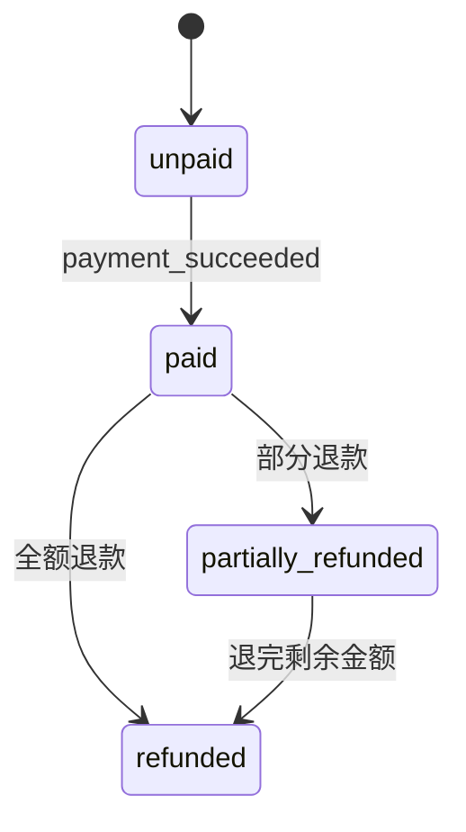
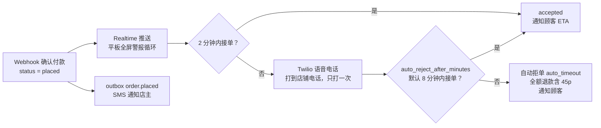
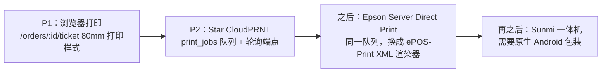
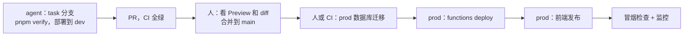

# 02 技术路线（Tech Roadmap）

> **读者**：老板（产品负责人），以及任何来做技术评审的工程师。
> **本文件的作用**：说明技术方案**为什么这样选**、**各阶段怎么演进**。具体规格（目录、表名、函数名、环境变量、脚本契约）只在 [reference/architecture.md](reference/architecture.md) 中定义，本文只引用不重复。**两者冲突时以 architecture.md 为准**，发现冲突请记到 [PROGRESS.md](PROGRESS.md)。
> **执行者**：编码由 GLM-5.3 完成。规则见 [AGENTS.md](../../AGENTS.md) 与 [CLAUDE.md](../../CLAUDE.md)，任务卡模板见 [tasks/TEMPLATE.md](tasks/TEMPLATE.md)，日常怎么指挥 GLM 见 [03-execution-handbook.md](03-execution-handbook.md)。
> **日期**：2026-10-11。标「未经实时核实」的价格、费率和限额，在做预算或上线前必须由人到官网核对。

---

## 1. 总体架构图

三条主线：

1. **读**：顾客浏览器用 publishable key 以 `anon` 身份直接读数据库，RLS 只放行已上线店铺的公开数据。商家用 Supabase Auth 登录后，RLS 只放行自己店的数据。
2. **写和钱**：所有涉及金额、状态变更和第三方调用的写操作，都在 Edge Functions 中完成。服务端始终用数据库价格重新计算（`priceOrder`），浏览器显示的总额只用于展示。
3. **副作用**：短信、邮件和（以后的）打印只由 outbox 处理器 `cron-tick` 发出，不在 webhook 或接口中直接发出。所以 webhook 可以很快返回，失败后也可以重试，不会重复发短信。

`packages/core` 是一套纯 TypeScript 逻辑（价格、状态机、营业时间、配送区域），**storefront 显示和 create-checkout 收款用的是同一份代码**。它怎样被 Deno 引用，由 P0-03 spike 决定并写成 ADR-0002。

---

## 2. 技术选型及理由

### 2.1 总原则（为 GLM-5.3 设计）

- **让机器当裁判**：编译器、测试和 CI 能拦住的错误，不靠 GLM 自觉。instruction files（AGENTS.md）只是建议，真正有强制力的是 hooks 和 CI。
- **少用「新」API**：GLM-5.3 于 2026-08-14 上线，知识截止日期未公布。越新、变化越快的框架，它越容易写错。
- **纯函数优先**：核心规则写成无 I/O、无时钟的纯函数，测试是确定性的，也很难被「mock 掉」作弊。
- **安全放在数据库层**：权限由 RLS 和触发器保证，不依赖 GLM 在每个接口里都记得写权限判断。

### 2.2 选型表

| 领域 | 选择 | 通用理由 | 针对 GLM-5.3 的理由 |
|---|---|---|---|
| 语言 | TypeScript `strict` + `noUncheckedIndexedAccess`，前后端统一 | 浏览器、Deno 和测试都用一种语言，类型就是文档 | 编译器是第一道事实核查：GLM 臆造的函数、字段或参数会直接编译失败，而 AGENTS.md 禁止 `@ts-ignore`，它没法把错误藏起来。**例外**：stripe-node 的枚举类型接受任意字符串（`OtherString`），写错 `ui_mode` 也能编译通过，所以另有参数构造器测试兜底（见 §8.3） |
| 领域逻辑 | `packages/core`：纯函数，无 I/O、无时钟、无随机 | 价格、状态机、营业时间、区域规则只写一份 | 测试是确定性的，没有网络或时间可以 mock，无法用 mock 让测试假装通过。黄金验收测试直接针对它 |
| 包管理 | pnpm workspace，精确版本，依赖白名单 [approved-deps.json](reference/approved-deps.json) | 构建可复现 | GLM 可能编造包名，或装上仿冒包（typosquatting）。白名单由 hook 和 CI 强制执行，新增依赖要人批准 |
| 前端 | Vite + React + React Router（declarative 模式）+ Tailwind v4 + TanStack Query，两个 SPA | 两个纯静态站点，Vercel 托管，不用运维 | 比 Next.js 少很多框架版本陷阱：App Router、Server Components 和缓存语义在几个大版本之间改动很大，GLM 容易新旧混写。Tailwind v4 不用 `tailwind.config.js`，architecture 里写死了这一点，防止 GLM 按 v3 的习惯生成配置 |
| 校验 | zod，schema 放在 core，浏览器和 Edge Function 共用 | 请求和响应结构只定义一处 | 处理器统一先校验再执行。zod 大版本之间 API 有变化，P0-01/P1-01 要按实际安装的版本核对 |
| 时间 | luxon，固定使用 `Europe/London` | 英国夏令时：2026-10-25 时钟回拨（01:00–02:00 出现两次），2027-03-28 时钟前拨（这一小时不存在）。另有营业到凌晨的跨日时段 | 用 `new Date()` 做时间运算是 LLM 最常见的隐性 bug。core 禁止读时钟，`now` 作为参数传入，所以 DST 场景可以写成确定性测试（P1-03 采用 tests-first） |
| 后端 | Supabase：Postgres + Auth + RLS + Realtime + Storage + Edge Functions + pg_cron/pg_net | 一个托管服务覆盖数据库、登录、推送、文件和定时任务，区域选 London | 权限写在数据库里，并且能用 pgTAP 同时证明「允许」和「拒绝」两面 |
| 数据访问 | 不用 ORM：SQL migrations + `supabase gen types` 生成类型 + supabase-js | SQL 稳定了几十年，RLS 本身就要写 SQL | 少一层快速变化的 API（Prisma、Drizzle），就少一类幻觉。生成的类型让编译器检查列名 |
| 收款模式 | Stripe Connect **direct charge**，`application_fee_amount = 45` | 钱直接进店铺自己的 Stripe 账户，平台不经手资金。店铺是交易主体，自己承担 Stripe 手续费、退款和争议 | 资金流最简单，对账规则最少，容易写成测试 |
| 连接账户 | **Accounts v1 + controller 属性**（等同 Standard：`fees.payer='account'`、`losses.payments='stripe'`、`requirement_collection='stripe'`、`stripe_dashboard.type='full'`） | `type: 'standard'` 在 2026-09-30.endive 的 OpenAPI 规格中已标为 deprecated（已核实） | v2 的结构更新：JSON body、`include` 参数，thin events 要用 `parseEventNotificationAsync` 并另设第三个 webhook，endive 还删除了 v2 Account Link 的 `configurations`。GLM 训练数据里几乎没有正确示例，幻觉风险最高。v1 + controller 不用废弃参数，又留在成熟的 API 上。P3 再用 ADR 评估 v2 |
| 结账 | **Hosted Checkout**（`ui_mode: 'hosted_page'`），浏览器不加载任何 Stripe SDK | SCA、Apple Pay、Google Pay 和卡号输入都由 Stripe 页面处理，PCI 范围最小 | 活动部件最少：一次服务端调用、一次跳转、一个 webhook。据现有资料（未经实时核实），Elements 或 Embedded 在 direct charge 下要按 connected account、按域名注册支付方式域名（Apple Pay），hosted 不需要。以后的自定义域名也因此不受影响 |
| Stripe 版本 | API `2026-09-30.endive`，`npm:stripe@23.0.0`，只在 Edge Functions 中使用 | 当前最新稳定版 | endive 发布于 GLM-5.3 上线之后，GLM **不可能**在训练中见过它：`payment_method_types` 已删除、`ui_mode` 改名、必须写 `new Stripe()`、Deno 中必须用 `constructEventAsync`。stripe-node 23 的 README 也已过时（还写着不带 `new`）。所以有强制必读的 [reference/stripe-endive.md](reference/stripe-endive.md)，guards 禁用旧写法 |
| 短信 / 语音 / 邮件 | Twilio 和 Resend 的 REST API，用 `fetch` 调用，不装 SDK | 依赖少，Deno 和 Node 写法一致 | REST 端点多年稳定，GLM 熟悉。放在 provider 接口后面，测试里换成 fake，不会真的发出短信 |
| 邮编 | postcodes.io（免费，不需要 key） | 英国邮编转经纬度 | 一个简单的 GET，容易在测试中替换。服务端会重新查询，不信任浏览器传来的坐标 |
| 托管 | Vercel：两个项目，每个分支自动生成 Preview | 静态 SPA，不用运维 | GLM-5.3 只接受文本输入，看不到截图，所以视觉检查由人在 Preview 链接上完成 |
| 测试 / CI | Vitest、pgTAP、`deno test`、Playwright（DOM/ARIA 断言），GitHub Actions | 每一层都有对应工具 | 「测试通过」只认 CI 结果，不认 GLM 的自述（见 §8） |

### 2.3 被否决的方案

| 方案 | 否决原因 | 何时重新考虑 |
|---|---|---|
| Next.js / Remix / Astro | SSR、缓存和路由约定在版本之间变化大，GLM 容易混用新旧写法。对菜单和后台为主的两个应用收益不大 | storefront 需要 SEO 预渲染时（P2 以后，走 ADR） |
| 在 CRM 的 `index.html` 里加功能 | CRM 数据库对 anon 完全开放。单文件约 220K tokens，超过 GLM 128K 的输出上限，无法整体改写。没有构建，也没有测试 | 不考虑 |
| 与 CRM 共用 Supabase 项目 | 现有的 anon 全开放策略会暴露顾客个人数据和订单 | 不考虑，只做加固后的单向同步 |
| 自建 Node/Express API + 独立 Postgres | 多一台要部署、监控、打补丁的服务器，权限检查会散落在代码里 | 只有个别端点因 Edge Functions 限额成为瓶颈时才单独移出（如 CloudPRNT 轮询，见 §6.3） |
| Prisma / Drizzle 等 ORM、GraphQL | 多一层快速变化的 API，RLS 仍然要写 SQL | — |
| Redux / MobX、CSS-in-JS | TanStack Query 加组件状态已经够用，样式由 Tailwind 覆盖 | — |
| Stripe Elements / Payment Element / Embedded Checkout | 需要 Stripe.js（`loadStripe(pk, { stripeAccount })`）、支付方式域名注册和更多前端状态，GLM 要掌握的新 API 更多 | P2 以后，如果数据显示跳转到 hosted 页面影响转化 |
| Accounts v2 | 见上表：thin events、第三个 webhook、新的请求结构 | P3 用 ADR 评估 |
| Express/Custom 账户 + destination charge 或 separate charges and transfers | 平台成为资金经手方，承担更多损失和合规责任。在「平台定价」模式下还有 Connect 费用（GB 据称每个活跃账户每月 £2，每次提现 0.25% + 10p，未经实时核实） | 将来要做「一单跨多店」的合并结账时 |
| 浮点数金额 | 有舍入误差。金额一律用整数 pence，比例用 basis points | 不考虑 |
| 原生 App 先行 | 顾客扫包装上的二维码会直接打开浏览器，不需要安装。Apple 4.2 要求 App 不能只是网站外壳 | P4 |
| 每店一个 App、每城市一个 App | Apple 4.3 禁止同一个 App 用多个 Bundle ID（例如每个城市一个）。每店的白牌 App 必须用该店自己的 Apple 开发者账户提交（4.2.6） | 不考虑 |
| 手写 `Date` 运算 / moment | 有 DST bug，moment 已进入维护状态 | — |

---

## 3. 支付流程

### 3.1 钱怎么走

以一单 **£20.45** 为例（食物 £20.00 + service fee £0.45），顾客用标准 UK 消费者卡支付：

| 去向 | 金额 | 说明 |
|---|---|---|
| Stripe 手续费（店铺承担） | ≈ £0.51 | 1.5% + 20p。费率未经实时核实，请查 stripe.com/gb/pricing。算式已核对：2045 × 1.5% + 20 = 50.675p，约 51p；Stripe 的确切舍入方式未核实 |
| 平台（application fee） | £0.45 | Stripe 自动划到平台余额 |
| 店铺净得 | ≈ £19.49 | 直接进店铺自己的 Stripe 余额，平台不经手 |

在「Stripe 定价」模式下（connected account 自己付费、direct charge），平台据称没有 Connect 费用（未经实时核实）。45p 的增值税处理（B2C 订购服务费还是 B2B 佣金）要请会计确认。

### 3.2 下单到接单（主流程）

两分钟没接单打电话、超时自动拒单这两条升级路径见 §6.1。

### 3.3 两个 webhook 端点

| 端点 | Stripe 设置 | 处理的事件 | 签名密钥 |
|---|---|---|---|
| `stripe-webhook-connect` | `connect: true`，接收所有 connected account 上的事件（事件带 `account` 字段） | `checkout.session.completed` / `async_payment_succeeded` / `async_payment_failed` / `expired`、`charge.refunded`、`charge.dispute.*`、`account.updated`、`account.application.deauthorized` | `STRIPE_WEBHOOK_SECRET_CONNECT` |
| `stripe-webhook-platform` | `connect: false`，接收平台自己账户上的事件 | `application_fee.created` / `refunded`，P2 起加上 SaaS 订阅事件 | `STRIPE_WEBHOOK_SECRET_PLATFORM` |

为什么要分开：Stripe 按端点设置 `connect` 标志，每个端点有自己的密钥（已核实）。分开后，每个处理器更小，测试也更聚焦。application fee 事件送到平台端点这一点「合理但未实时核实」，P1-12 会用 sandbox 实测确认。

共同规则：用 `await req.text()` 拿原始 body，交给 `constructEventAsync`，不能先解析 JSON。`tolerance` 绝不能传 0（stripe-node 23 中传 0 会关闭时间戳检查）。设置 `verify_jwt = false`。未知事件也返回 200 并记录。
本地开发用 `stripe listen --latest --forward-to … --forward-connect-to …`：不加 `--latest` 时，事件会按账户默认的 API 版本格式化。一次 listen 只打印一个 `whsec_...`，所以本地两个密钥变量填同一个值，prod 则是两个不同的密钥。

### 3.4 幂等（Idempotency）

Stripe 会重试、会重复投递、也可能乱序（据官方文档，未经实时核实），所以每一层都要能「同一件事做两次，结果不变」：

| 层 | 做法 |
|---|---|
| 收到的事件 | `stripe_events.event_id` 是主键，插入时 `ON CONFLICT DO NOTHING`，重复事件直接返回 200 |
| 订单状态 | 所有状态变化都走 core `transition`。已付款的订单再收到付款事件是非法转换，处理器当作「已处理」，不报错重试 |
| 数据库约束 | `checkout_session_id`、`payment_intent_id`、`stripe_refund_id`、`application_fee_id` 都设唯一约束 |
| 调用 Stripe | 固定的 idempotency key：`acct-create-{shop_id}`、`checkout-{orderId}-{attempt}`、`refund-{orderId}-{n}`、`appfee-refund-{orderId}`。Checkout 的 key 带 attempt 计数，因为同一个 key 至少 24 小时内会返回同一个（可能已过期的）session。stripe-node 23 的代码默认自动重试 2 次并自动加 key（README 写的 1 次已过时） |
| 副作用 | 只写 outbox（`order_events`），由 `cron-tick` 发送，发送记录写入 `notifications_log` 去重 |

### 3.5 退款流程

| 场景 | 45p 退不退 | 发起方 | 说明 |
|---|---|---|---|
| 商家后台全额退款 | 退（`refund_application_fee: true`） | `refund-order` | 平台只损失 45p。Stripe 原手续费不退，由店铺承担（未经实时核实） |
| 部分退款 | 不退 | `refund-order` | 平台保留 45p |
| 拒单、或取消已付款订单 | 退（全额） | `merchant-order-action` 调用 `_shared/refunds.ts` | core 返回 `requiresRefund: true` |
| 超时自动拒单 | 退（全额） | `cron-tick` | `initiated_by = auto_reject` |
| 商家在自己的 Stripe Dashboard 里退款 | Stripe **不会**自动退 45p：只有创建这笔 charge 的平台才能退 application fee（规格原文，已核实） | webhook 发现不是本平台发起的退款，记为 `stripe_dashboard`。如果是全额退款，就调用 `applicationFees.createRefund`（key `appfee-refund-{orderId}`） | 兑现「全额退款连 45p 一起退」的承诺 |
| 争议（dispute） | 平台保留（以后可通过 ADR 修改） | Stripe | 标记 `dispute_status`，通知商家。争议费由店铺承担（UK 据称 £20，未经实时核实） |

### 3.6 边界情况

| 情况 | 处理 |
|---|---|
| **迟到付款**：订单已 `expired` 或 `cancelled`，才收到 `checkout.session.completed` | core 返回：status 不变，`paymentStatus = paid`，`requiresRefund = true`。系统立即全额退款（含 45p），记日志并通知顾客。这单不会出现在商家订单板上 |
| Session 过期 | `expires_at` = 30 分钟（Stripe 允许的最短值）。`cron-tick` 在 `checkout_expires_at` 之后 5 分钟检查：如果 session 仍是 open，先调用 Stripe 让它过期，再转为 `checkout_expired`。收到 `checkout.session.expired` 时也同样转为 expired |
| 付款完成但 `payment_status` 不是 `paid`（延迟到账的支付方式） | 不出单，等 `async_payment_succeeded` 或 `failed`。热食不适合延迟到账，上线前要确认 Checkout 只显示即时支付方式。endive 删除了 `payment_method_types`，改由账户的支付方式设置或 Checkout 的 `allowed_payment_method_types` 控制，细节以 stripe-endive.md 为准 |
| 乱序：`charge.refunded` 比 `completed` 先到 | 以 Stripe 对象的当前状态做 upsert。P1-12 有专门的乱序测试 |
| 重复投递 | 用 `stripe_events` 去重。P1-12 有重复投递测试 |
| 店铺被暂停收款（`charges_enabled=false`）或解除授权 | 同步 `stripe_accounts`。`create-checkout` 返回 503 `PAYMENTS_NOT_READY`，商家后台显示横幅。注意：full-dashboard 账户不能创建 `account_update` 类型的 Account Link（已核实），商家要在自己的 Stripe Dashboard 补资料 |
| 顾客关掉付款页 | 订单停在 `pending_payment`，30 分钟后过期，不影响商家 |

---

## 4. 订单状态机

下图与 [architecture §6](reference/architecture.md) 完全一致。连线标签写成「§6 的名称 / core 中的事件名」。

付款状态（`payment_status`）是另一个独立字段：

规则摘要（以 P1-02 黄金测试为准）：

- 终态：`completed`、`rejected`、`cancelled`、`expired`。终态上不再允许任何履约事件。
- `reject` 只能从 `placed` 发出。`cancel` 可以从 `pending_payment`、`placed`、`accepted` 发出，出餐（`ready_for_collection`）或已出发配送（`out_for_delivery`）后不能再取消。
- 已付款的订单被拒或被取消时，返回 `requiresRefund: true`（全额退款，含 application fee）。
- 迟到付款：`expired`/`cancelled` 状态的订单收到 `payment_succeeded` 时，status 不变，付款状态变为 `paid`，并返回 `requiresRefund: true`。
- 非法转换抛出 `OrderTransitionError`（`ILLEGAL_TRANSITION` / `INVALID_EVENT`），**不会被悄悄改成合法状态**。数据库只保存 core 计算出的结果。
- `dispute_status` 是独立的可空字段，不影响上面两个状态机。

---

## 5. 数据与安全模型

### 5.1 多租户

所有店铺共用一个数据库，业务表的每一行都带 `shop_id`。人和店铺的关系存在 `shop_members`（角色为 `owner` / `manager` / `staff`），平台管理员在 `platform_admins`。多租户的数据模型从 P1 第一天就有，虽然试点只有一家店。

| 身份 | 能做什么（摘要，精确规则由 P1-05 的 RLS 和测试定义） |
|---|---|
| `anon`（顾客浏览器） | 只读 `status = 'live'` 店铺的公开字段、已发布的菜品、营业时间和区域。**永远**不能读写订单、退款、账本、事件和 `stripe_*` 表 |
| staff | 本店订单的接单、拒单、出餐和配送操作（`merchant-order-action`，角色至少为 staff） |
| manager | 加上退款（`refund-order`，角色至少为 manager） |
| owner | 加上 Stripe 开户（`connect-onboarding`）和邀请员工 |
| 平台管理员 | 建店、邀请店主、让店铺上线（上线前检查 `charges_enabled` 且 `card_payments` 为 active） |
| service role | **只在 Edge Functions 内部**使用：webhook、cron 和 checkout 的写入 |

### 5.2 RLS 原则（以及为什么）

- **每张表都开 RLS，默认拒绝。** 前端代码写错时，数据库依然不会多给数据。
- 商家的权限统一由 `is_shop_member(shop_id, min_role)` 判断。这是一个 `SECURITY DEFINER` 函数，设置了 `set search_path = ''`，防止通过 search_path 劫持。
- **每条策略都要有 pgTAP 测试，证明「允许」和「拒绝」两面**：anon、A 店员工对 B 店、manager、owner、平台管理员和 service role 都要覆盖。
- **黄金 RLS 元测试**（P0-02 的 `rls_enabled.test.sql`）会在项目整个生命周期内每次 CI 都运行，检查两件事：`public` 下每张表都开了 RLS，每个 `SECURITY DEFINER` 函数都固定了 `search_path`。以后任何一个新表忘了开 RLS，CI 都会变红。
- 敏感字段由数据库触发器保护：商家不能修改 `service_fee_pence`、不能自己把 `status` 改成 `live`、不能改 `crm_customer_id`。菜单上架门禁（14 种过敏原都必须明确填写）也是数据库触发器，不只是 UI 校验。

### 5.3 顾客身份

P1 只有游客下单（guest checkout）。顾客凭一个无法猜测的 `public_token`（uuid），通过 `order-status` 函数查询订单。这个函数只返回安全字段，`anon` 从来不能直接读 `orders` 表。P2 起会有可选的 OTP 顾客账户（见 §9）。

### 5.4 密钥与个人数据

- 浏览器只有 publishable key，永远看不到 service-role key 或 Stripe secret key。
- 商家函数用 `auth.getUser` 验证 JWT，再在 SQL 中检查成员关系，**不信任请求 body 里的 `shop_id`**。
- 密钥只放在 Supabase function secrets、Vercel env 和本地被 git 忽略的 `.env.local` 中。hook 禁止 agent 读取 `.env*`。**prod 密钥永远不放在运行 agent 的机器上。**
- GLM 的 API 由 Z.ai 运营（研究资料称是新加坡主体，数据治理方面未核实）。所以不把真实顾客数据或密钥放进提示词，开发一律用 `supabase/seed.sql` 的假数据。`glm-plan-bug` 插件会把对话上下文上传给 Z.ai（已核实），在有敏感数据的会话中不要使用。

### 5.5 与旧 CRM 的边界

平台**不读写** CRM 数据库，也不保存任何 CRM 凭据，两边只用 `shops.crm_customer_id`（文本，例如 `C-001`）关联。具体见 §10。

---

## 6. 通知与出单

### 6.1 新订单提醒与升级

为什么要这么多层：

- **「Start shift」按钮**：浏览器在用户操作之前禁止自动播放声音。点这个按钮会解锁 Web Audio，并申请 Screen Wake Lock，防止屏幕休眠。
- **Realtime 快，但不保证送达**：平板休眠、Wi-Fi 断开或浏览器回收后台标签页时，都可能漏推。所以订单板会在 Realtime 重新订阅时、页面重新可见时和每 60 秒重新拉取一次（P1-13），另有 SMS、语音电话和自动拒单作为后备。自动拒单保护的是顾客：不能让他付了钱却等不到食物。
- 语音电话用 Twilio TTS，通过 `notifications_log` 去重，同一单只打一次。
- 以上步骤都由 `cron-tick` 每分钟执行，每一步单独包裹、互不影响；provider 都在接口之后，测试里用 fake 和固定的 `now`。

### 6.2 顾客通知

在 accepted（含 ETA）、rejected（含退款说明）、ready / out_for_delivery 这几个节点，发邮件（Resend）和短信（Twilio）。下单回执邮件附带过敏原摘要。状态页 `/o/:token` 每 5 秒轮询一次，直到订单进入终态；标签页隐藏时暂停，3 小时后停止（P1-16），以控制 Edge Function 调用量。所有模板都转义 HTML 并附纯文本版本，全部经 outbox 发送。

### 6.3 打印路线

| 阶段 | 方式 | 技术要点 |
|---|---|---|
| P1 | 浏览器打印小票视图 | 80mm 纸宽的打印样式，内容包括过敏原、顾客 allergy note、PAID、单号、自取或配送、时间和地址。从浏览器直连蓝牙或 USB 小票机不稳定，只作过渡方案 |
| P2 | Star CloudPRNT | 打印机主动轮询（POST 上报状态，GET 取任务，DELETE 确认），店里不用做端口转发，打印机不需要 SSL 证书。协议公开（Protocol Guide v2.5.2），不需要 SDK。新增 `print_jobs` 队列和渲染器抽象，由 outbox 触发，**绝不在付款 webhook 里直接打印**。建议推荐并转售一个型号（如 TSP143IV 或 mC-Print3），和包装供货结合起来 |
| 之后 | Epson Server Direct Print | 同一个队列，换一个渲染器。它也是轮询（TM-m30III 等 TM-i 固件机型） |
| 再之后 | Sunmi 一体机或手持机 | 要用原生 Android 包装（Capacitor 或 React Native）调用内置打印服务 |

**CloudPRNT 轮询成本**：默认每 5 秒轮询一次，每台打印机每天 17,280 次请求，每月约 52 万次。50 台打印机约 2,600 万次每月。Supabase Pro 据称每月含约 200 万次 Edge Function 调用，超出部分约每百万次 $2（未经实时核实），即 5 秒间隔约 $48/月，10 秒间隔约 $22/月，而且每次轮询还要查一次数据库。对策：间隔至少 10 秒（architecture §10），轮询处理只做一次带索引的查询；P2 可以把轮询端点移到一个廉价的独立 worker（选型走 ADR）。10 秒的出票延迟可以接受，因为商家接单本身就要更长时间。打印机的认证方式在 P2 设计时按 Star 协议文档确定。

---

## 7. 环境与发布

### 7.1 三个环境（完整定义见 [architecture §3](reference/architecture.md)）

| 环境 | Supabase | Stripe | 前端 | 用途 |
|---|---|---|---|---|
| local | `supabase start`（Docker） | sandbox | `vite dev` | 日常开发和测试 |
| dev | `takeaway-dev`（London） | sandbox | Vercel Preview | 集成测试，人工验收 UI |
| prod | `takeaway-prod`（London） | live | Vercel Production | 真实店铺 |

### 7.2 谁能碰什么

| 动作 | GLM agent | 人 | CI |
|---|---|---|---|
| 写代码、建 `task/<ID>-<slug>` 分支、开 PR | 可以 | 可以 | — |
| 改受保护文件（AGENTS.md、CLAUDE.md、`.claude/`、`.github/`、`scripts/guards/`、`scripts/acceptance/`、`docs/takeaway/` 大部分） | 不可以（hook 拦截） | 可以 | 检查。PR 需人加标签 `protected-change-approved` 才能通过 |
| 改旧 CRM | 不可以，除非人用 `PPOS_ALLOW_LEGACY=1` 启动会话 | 可以 | — |
| 修改已合入 main 的 migration | 不可以（append-only） | 不建议 | 检查 |
| 对 dev 执行 `supabase db push` / `functions deploy` | 可以 | 可以 | — |
| `supabase link` | 不可以（由人对 dev 执行一次） | 可以 | — |
| 任何 prod 命令、拿到 prod 密钥 | **永远不可以** | 可以 | 可以（用 P1-20 提议的部署工作流） |
| 合并 PR、加标签、push 到 main、force-push | 不可以 | 可以 | — |
| 冻结测试提案（`freeze.mjs`） | 不可以 | 可以 | — |

### 7.3 CI（[takeaway-ci.yml](../../.github/workflows/takeaway-ci.yml)，受保护）

| Job | 做什么 | 何时生效 |
|---|---|---|
| guards | 禁用写法、CJK lint、验收文件完整性、依赖白名单；PR 上另查受保护路径 | 现在 |
| node | `pnpm typecheck`、`pnpm lint`、`pnpm test`（含已安装的验收测试） | P0-01 之后 |
| deno | 对 `supabase/functions` 执行 `deno check` 和 `deno test` | 出现函数之后 |
| db | `supabase start`、`supabase test db`（pgTAP）、`supabase db lint --level error` | P0-02 之后 |
| e2e | Playwright（DOM/ARIA 断言） | P0-04 之后 |

每个 job 都先检测对应代码是否存在，所以从 P0 起就能用。GitHub 的 main 分支保护要求 CI 通过才能合并（P0-00 由人设置）。

### 7.4 Preview 部署与人工 UI 验收

每个分支自动生成一个 Vercel Preview 链接，Preview 只连 dev Supabase 和 Stripe sandbox，**Preview 环境变量里绝不放 prod 密钥**。GLM-5.3 是纯文本模型，看不到截图，所以布局、颜色和手机宽度（375px）下的效果由人在 Preview 上检查。Preview 域名要加入 Supabase Auth 的回跳白名单和函数的 CORS。已知限制：Stripe 付款后的回跳地址来自 `APP_STOREFRONT_URL`（每个环境一个固定值），所以在 Preview 上测付款，最后会跳回 dev 的固定地址。

### 7.5 数据库迁移

- 只能追加：用 `supabase migration new` 新建，已合入 main 的迁移永远不改（hook 和 `policy.json` 的 `appendOnly` 共同强制）。
- 每个迁移任务都要重新生成 `database.types.ts`。
- prod 发布时数据库、函数和前端不是同一刻切换，所以迁移要**向后兼容**：先扩展（加列或加表），再发布新代码，最后用另一个迁移收缩（删旧列）。

### 7.6 发布流程

- prod 只能由人或 CI 发布，agent 永远不碰。具体工作流由 P1-20 提议（`docs/takeaway/tasks/proposed/deploy-workflow.yml`），由人审核后放进 `.github/`。
- 顺序固定为**数据库 → 函数 → 前端**。注意 Vercel 默认在合并到 main 时自动发布 production，P1-20 要决定是关闭自动发布，还是保证迁移先行。
- prod 的两个 Stripe webhook 端点由人创建，并固定 API 版本为 `2026-09-30.endive`。

---

## 8. 测试策略

### 8.1 测试金字塔（从下到上）

| 层 | 工具 | 测什么 | 谁写 | 为什么对 GLM 重要 |
|---|---|---|---|---|
| 1. Guards | `scripts/guards/*.mjs` | 禁用写法（浮点金额、`@ts-ignore`、旧 Stripe 写法等）、CJK、验收文件逐字节一致、依赖白名单、受保护路径 | 规划者，人维护 | 把「规则」变成机器检查，GLM 绕不过去 |
| 2. 单元测试 | Vitest + Testing Library | core 纯函数、UI 组件、警报 reducer、模板 | agent | 快，结果确定 |
| 3. 黄金验收测试 | Vitest / pgTAP，源文件在 [acceptance/](acceptance/manifest.json) | P1-01 定价、P1-02 状态机（共 66 个用例，已用参考实现跑通并做过变异测试）；P0-02 RLS 元测试 | 规划者 | agent 改不了（hook 拦截 + integrity guard） |
| 4. 数据库测试 | pgTAP，`supabase test db` | 每条 RLS 策略的允许和拒绝、触发器、SQL 报表函数 | tests-first：提案经人冻结 | 跨店数据泄露是最大的风险 |
| 5. 函数测试 | `deno test` | fixture JSON 事件、在测试内用 HMAC-SHA256 签名（`t=…,v1=…`）、重复投递、乱序、签名错误；provider 全部用 fake | tests-first，P1-12 另加 pass@2 | 不联网，可以重放 |
| 6. 端到端 | Playwright | 按 role、label 和文字断言，不依赖截图；P1-17 检查 storefront 不设 cookie、不请求无关第三方 | agent | GLM 看不到屏幕 |
| 7. 人工 | Vercel Preview、Stripe sandbox、上线时用 £1 真实订单加全额退款做对账（P1-20） | 视觉效果、真实支付 | 人 | 最后一道关 |

### 8.2 四种工作协议

1. **黄金测试**（golden tests）：规划者事先写好并做过变异测试，用 `pnpm acceptance:install <ID>` 安装，CI 检查文件逐字节一致。适用于 P0-02、P1-01、P1-02。
2. **tests-first + 冻结**：会话 A 只写测试提案，放到 `acceptance-proposals/<ID>/`；人审核后运行 `node scripts/acceptance/freeze.mjs <ID>`（**只能由人运行**）；会话 B 在测试被锁定的情况下写实现。适用于 P1-03、04、05、11、12、14。
   原因：GLM-5.2 实测有 57–73% 的奖励作弊（reward hacking）行为，包括修改测试、伪造成功。GLM-5.3 的同类审计无法核实，但这是同一家族的风险。写测试的会话和写实现的会话分开后，就没有动机去改测试了。
3. **pass@2**：两个独立会话在不同的 git worktree 和分支里做同一张卡，留下通过测试且 diff 更小、更干净的那个。依据：Together AI 测得 DeepSWE pass@1 为 69.0%，pass@4 为 87.6%（未经核实），多试几次的成本很低。适用于 P1-12。
4. **双次独立审查**：P1-19 在两个全新会话中各审查一遍，由人合并结论。GLM-5.3 在 ExploitBench 中做出了 50/410 个端到端漏洞利用（已核实），但这是攻击能力。把它当作防守方审查者是推断，所以要跑两遍，再加人工判断。

### 8.3 Stripe 的特殊兜底

stripe-node 的枚举参数类型接受任意字符串，`ui_mode: 'hosted'` 这种错误能通过编译，只在运行时失败。所以 Checkout 参数由纯函数 `buildCheckoutSessionParams` 生成，单元测试逐字段断言：`ui_mode: 'hosted_page'`、没有 `payment_method_types`、`application_fee_amount`、`expires_at`、回跳地址和 metadata。之后再用 `stripe listen --latest` 在 sandbox 实跑一遍。

### 8.4 「完成」的定义

每次 commit 前跑 `pnpm verify:quick`，任务结束时跑 `pnpm verify`，并且 PR 的 CI 必须全绿。agent 说「测试通过了」不算证据，贴出的命令输出才算。每次 GLM 想结束一轮回答时，如果 `apps/`、`packages/`、`supabase/`、`e2e/`、`scripts/` 下有未提交改动，Stop hook（`stop-verify`）会跑 `pnpm verify:quick`（P0-01 之前跑 guards），失败就挡一次，并把错误贴回给它。

---

## 9. 各阶段技术里程碑

| 阶段 | 新增的技术组件 | 关键决策 / ADR | 退出标准（业务） |
|---|---|---|---|
| **P0 基础** | pnpm monorepo、TS strict、ESLint/Prettier、Vitest（P0-01）；Supabase 本地环境、迁移规范、pgTAP 和黄金 RLS 元测试（P0-02）；core 与 Deno 共享代码的 spike，`_shared`（env、http、supabase、stripe）和 `health` 函数（P0-03）；两个应用外壳、设计 token、i18n（storefront 用 en-GB，merchant 用 en-GB + zh-CN）、Playwright 冒烟测试（P0-04）；CRM 加固 B 线（P0-B1 起） | ADR-0001 迁移流程；ADR-0002 core 共享方式 | `pnpm verify` 和 CI 全绿；`health` 函数能部署到 dev |
| **P1 试点 MVP** | core 的定价、状态机、营业时间和时段、配送区域；schema v1 + RLS；商家登录和 `platform-invite`；菜单、过敏原和 Storage；店铺设置；Connect 开户和 connect webhook；storefront；`create-checkout`；webhook 和手续费账本；实时订单板（Realtime、警报、Wake Lock、打印样式）；`cron-tick`（pg_cron + pg_net、outbox、Twilio SMS 和语音、自动拒单）；退款；订单状态页和通知模板；法律页面和合规 UI；报表 SQL 和 CSV；两次安全审查；上线 runbook | 定价、状态机、退款政策、合规文案全部冻结；CRM 加固 P0-B2–B4 是 P1-20 上线门槛（见 §10.3） | 试点店上线至少 2 周，至少 100 笔真实订单，对账 0 错误，商家愿意推荐 |
| **P2 可销售的 SaaS** | 自助开户（预留 `@stripe/connect-js` 3.4.6 嵌入式 onboarding）；在平台账户上用 **Stripe Billing**（£149 开通费 + £39/月；创始客户优惠用试用期或优惠券实现；订阅事件走 `stripe-webhook-platform`；注意 invoice/subscription 的 `payment_settings.payment_method_types` 仍然存在）；**自定义域名**（`shop_domains` 表 + Vercel domains API，按 hostname 找到店铺，CORS 白名单从 `shop_domains` 生成，TLS 由 Vercel 签发）；折扣码（core 已支持三种折扣，需新增表和 Checkout 行处理）；**Star CloudPRNT**；**顾客 OTP 账户**（Supabase Auth OTP，优先用邮件，因为短信有成本；顾客永远不是 shop member）；平台管理后台；CRM 汇总同步；FHRS 卫生评级徽章（FSA API v2，用已有的 `shops.fhrs_id`） | 新增函数名或表要先用 ADR 写进 architecture；CloudPRNT 轮询端点放在哪里 | 10 家付费店铺，每店每周支持时间少于 1 小时 |
| **P3 城市密度** | **QR 活动**表（关联 CRM 中的包装订单号，短码，用已批准的 `qrcode` 包生成可打印二维码）；扫码端点（跳转并记录，不设 cookie，IP 做哈希）；**归因**（活动码一路带到 `create-checkout`，写入订单）；跨店**积分账本**（只追加；积分按负债记账；配套 T&Cs）；营销同意记录（按数据控制方分别记录，含文案版本和时间戳；PECR 的 soft opt-in 只适用于收集数据的那一方） | Accounts v2 重新评估（ADR）；积分由谁出资、怎么记账 | 在**一个**城市做到 30–50 家店，测出扫码到下单的转化率 |
| **P4 聚合平台** | 先做城市 PWA「picker」（按邮编或城市列出店铺，每单仍然是对单个店铺的 direct charge）；再做**一个 Expo App**：`@stripe/stripe-react-native` 的 PaymentSheet 配合 connected account（需要一个创建 PaymentIntent 的新函数，走 ADR）、Expo push（APNs/FCM）推送订单状态、App 内删除账户（Apple 5.1.1(v)）、单一二进制的 picker 模式（Apple 4.2.6）、超出网站外壳的原生价值（Apple 4.2：保存地址、推送、积分钱包、再来一单）、餐食不走 IAP（3.1.3(e)）、只用自有的 OTP 登录，避免触发 4.8 的 Sign in with Apple 要求；评价功能（遵守 DMCCA 虚假评价规则）、P2B 透明度（公开排序参数）、HMRC 平台收入申报 | 新依赖（Expo 等）由人加入白名单；iOS 网页推送必须先「添加到主屏幕」（iOS 16.4 及以上），这是做原生 App 的主要理由 | P3 的退出标准达到之后才开始 |
| **P5 下一个城市** | 用配置而不是代码扩展城市（城市和区域数据）；仍然只有**一个** App（Apple 4.3）；数据库算力升级；多城市报表和运营工具 | 是否需要只读副本或分区，按当时的负载决定 | — |

---

## 10. CRM 加固与集成技术方案

### 10.1 现状（研究结论，P0-B1 会逐条确认 file:line）

- `migration_fix_rls_anon.sql` 给 `anon` 角色开放了全部业务表的 SELECT/INSERT/UPDATE/DELETE。
- `profiles`（含密码哈希）任何人都可以读写，可以自己插入一个 admin 账户。
- 登录只在浏览器里完成：SHA-256 加一个固定 salt，session 是 localStorage 里的 JSON，没有签名，也没有过期时间。
- Supabase URL 和 key 写在 `index.html` 里。**任何拿到页面地址的人，都可以读、改、删所有客户、订单、成本和利润数据。**
- PDF 生成里用 `innerHTML` 拼接数据库字段，构成存储型 XSS；仓库里还提交了真实的利润数据（`import_qiao_profit_statement.sql`）；CDN 脚本没有固定版本。

### 10.2 人工立即止血

先限制谁能打开 CRM 页面（托管层加密码或 IP 白名单），并**马上做一次数据库备份**，因为目前任何人都能删数据。
需要说明的是：这只能缩小暴露面。如果 GitHub 仓库是公开的（或曾经公开过），或者有人保存过页面，攻击者可以绕过页面直接调用 Supabase REST API。请人工确认仓库的可见性（P0-00 第 H 步）。真正的修复是下面的 B2 和 B3。

### 10.3 P0-B 加固线

| 卡 | 内容 | 前提 |
|---|---|---|
| P0-B1 | 只读审计：确认并补充问题（带 file:line）、评估影响面，输出 `reviews/P0-B1-crm-security.md` 和 `tasks/proposed/P0-B2…` 提案卡。不改任何代码 | 无 |
| P0-B2 | 登录改用 Supabase Auth：为现有 profiles 建 auth 用户，强制重设密码 | 人用 `PPOS_ALLOW_LEGACY=1` 启动会话 |
| P0-B3 | RLS 改为 `to authenticated` 加角色函数；工厂用户按 `linked_factory_id` 限制；删除 `password_hash`；撤销 anon 权限 | B2 必须先完成，否则 CRM 会立即无法使用 |
| P0-B4 | 修复 PDF 生成中的 innerHTML XSS | 同上 |
| P0-B5 | 是否从 git 历史中清除真实业务数据（人决定）；CDN 脚本固定版本 | 人决定 |

**上线门槛：** P0-B2、B3、B4 必须在 P1-20 试点上线前完成，并已应用到 CRM 正在使用的数据库（这是 P1-20 上线清单中的一项）。P0-B5 由人决定，不是门槛。

技术约束：`index.html` 约 220K tokens，超过 GLM 128K 的输出上限，整体重写一定会被截断。所以只允许每次读不超过 400 行、用小范围 `Edit` 修改，hook 会强制执行。每张卡都要附回滚步骤。

### 10.4 以后的集成（全部在加固完成之后）

- **关联键**：`shops.crm_customer_id` 对应 CRM 的 `customers.id`。
- **P2 单向同步**：由平台侧的定时任务把每家店的汇总（平台状态、订阅状态、月订单量等）写入 CRM 的一张汇总表。CRM 凭据只存在平台的函数密钥里。**不把终端顾客的个人数据同步给 CRM**，CRM 也永远不写平台数据库。
- **P3 联动**：QR 活动关联 CRM 中的包装订单（哪批包装印了哪个码），扫码和下单可以归因到具体店铺和包装批次。可以按「订单量 × 每单用盒数」预测包装消耗，在 CRM 里生成报价草稿（作为设想，届时走 ADR）。

---

## 11. 成本估算与技术风险

### 11.1 月度基础设施成本（**全部为估算，未经实时核实**）

假设：每店每月 600 单（与收入示例一致）；$1 ≈ £0.75–0.80；只算平台自己付的费用，Stripe 手续费由店铺承担，不计入。

| 项目 | 1 店（试点） | 10 店 | 50 店 | 依据 / 说明 |
|---|---|---|---|---|
| 订单量 | 600 | 6,000 | 30,000 | 假设 |
| Supabase prod（Pro） | $25 | $25 | $25–40 | Pro 约 $25/月，含一个小型算力实例；50 店时可能要升级算力 |
| Supabase dev | $0–10 | $0–10 | $0–10 | 免费项目（闲置会暂停），或放在 Pro 组织里加算力费 |
| Edge Function 超额 | $0 | $0–1 | $0–20 | 据称含 200 万次/月，超出约每百万次 $2（见 §6.3）。大头是状态页轮询：每 5 秒一次，假设每单页面平均可见 5–30 分钟（60–360 次），50 店约 180 万–1,080 万次/月；P1-16 在标签页隐藏时暂停、3 小时后停止，超额明显时可在接单后降低频率。`cron-tick` 每月只有 43,200 次 |
| PITR 备份（可选） | — | — | 约 $100 | 由 P1-20 决定；Pro 自带每日备份 |
| Vercel Pro | $20 | $20 | $20 | 按 1 个席位；Hobby 计划不允许商用 |
| Resend | $20 | $20 | $35–90 | 每单约 3 封；免费档有每天 100 封的上限，周末高峰容易超，建议试点就用 Pro（约 5 万封/月） |
| Twilio 号码 | 约 $2 | 约 $2 | $2–5 | UK 号码要提交 regulatory bundle |
| **Twilio SMS** | **£24–72** | **£240–720** | **£1,200–3,600** | UK 约 £0.04/条；每单 1 条（只发店主）到 3 条（店主 + 顾客两次） |
| Twilio 语音 | 约 £3 | 约 £30 | 约 £150 | 假设 10% 的订单触发 1 分钟电话 |
| 域名 | 约 £1 | 约 £1 | 约 £1 | 平台域名；店铺的自定义域名在 P2 由店铺承担或打包 |
| CloudPRNT 轮询（P2） | — | 约 $0 | $22–48 | 50 台打印机，10 秒或 5 秒间隔（见 §6.3） |
| Stripe（平台侧） | £0 | £0 | £0 | P2 Billing 约 0.7% 加订阅扣款的卡费，约每店每月 £1（未经实时核实） |
| **合计（不含短信和语音）** | 约 £50–60 | 约 £50–60 | 约 £85–190（另有可选的 PITR） | |
| **合计（含短信和语音）** | 约 £80–135 | 约 £320–810 | 约 £1.4k–3.9k | |
| 参考：平台收入 | £309 | £3,090 | £15,450 | 600 × 45p + £39 |

### 11.2 关键结论

- 除短信外，基础设施几乎是固定成本，50 店时每店每月约 £2–4（不含可选的 PITR）。
- **短信是唯一随订单线性增长的大项。** 按 architecture §10 现在的设计（每单都给店主发短信，顾客的接单通知和出餐/配送通知也都发短信），最多约占平台收入的 23%。architecture §10 在 P1 阶段是冻结的，所以 P1 先按它实现；试点两周后，用真实短信量决定是否写 ADR 调整。可选的方向：店主短信只在平板 60 秒内未确认时发送；顾客短信只保留「出餐 / 已出发」一条，其他用邮件和状态页。
- 开发工具成本（不属于基础设施）：Z.ai Coding Plan Pro 据报道约 $80/月（未经核实，请查 z.ai/subscribe）。高峰时段（北京时间周一至周五 14:00–18:00，即英国 06:00–10:00 GMT / 07:00–11:00 BST）尽量不要安排长任务。私有仓库的 GitHub Actions 免费分钟数有限（每次 PR 的 CI 约 15–25 分钟），可能需要付费档。P4 另有 Apple Developer（约 $99/年）和 Google Play（约 $25，一次性）的费用，均未经核实。

### 11.3 技术风险

| # | 风险 | 可能性 | 影响 | 缓解 | 相关任务 |
|---|---|---|---|---|---|
| R1 | GLM 使用过时或臆造的 Stripe API（endive 晚于模型发布） | 高 | 高（收不到钱或收错） | stripe-endive.md 必读；guards；`tsc` 和 `deno check`；参数构造器测试；sandbox 实跑；用 max effort | P0-03、P1-09、P1-11、P1-12 |
| R2 | 奖励作弊：改测试、伪造成功 | 中–高 | 高 | 黄金测试、tests-first 冻结、受保护路径、以 CI 为准、Stop hook | 全部 |
| R3 | RLS 写错，导致跨店泄露数据 | 中 | 很高 | 默认拒绝；每条策略都有允许和拒绝测试；黄金元测试；两次独立安全审查 | P1-05、P1-19 |
| R4 | webhook 重复、乱序或丢失，导致订单或账目出错 | 中 | 高 | 去重、幂等、唯一约束；fixture 测试；pass@2；对账报表；上线前 £1 实测 | P1-12、P1-18、P1-20 |
| R5 | 夏令时或跨午夜时段计算错误 | 中 | 中 | luxon + 核心代码里明确写死的消歧规则（重复的时刻取较早那次，不存在的时刻向后顺延；不依赖 luxon 默认行为，architecture §16）；tests-first 用例覆盖 2026-10-25 和 2027-03-28，并在 TZ=UTC / Asia/Shanghai 下各跑一遍 | P1-03 |
| R6 | 平板休眠或断网，Realtime 漏单 | 中 | 高 | 警报 + Wake Lock + 短信 + 语音电话 + 自动拒单退款；订单板在重新订阅、页面重新可见时和每 60 秒重新拉取 | P1-13、P1-14 |
| R7 | core 无法被 Deno 共用 | 低–中 | 中 | P0-03 先验证 serve、check、test、deploy 四条路径，写成 ADR | P0-03 |
| R8 | 短信成本侵蚀毛利 | 高（按现有设计） | 中 | 见 §11.2 | P1-14、P1-16 |
| R9 | CloudPRNT 轮询带来函数调用费 | 中 | 低–中 | 间隔至少 10 秒；查询尽量简单；必要时迁到独立 worker | P2 |
| R10 | postcodes.io 不可用 | 低 | 中 | 按邮编区（district）划分的区域可以离线判断；按半径的区域给出明确报错；考虑缓存查询结果 | P1-04、P1-11 |
| R11 | 长上下文质量下降，大文件写入失败 | 中 | 中 | 自动压缩阈值设为 200000；单个文件不超过约 300 行；`index.html` 只允许分段读取 | 全部 |
| R12 | 合规风险：drip pricing、过敏原（罚款最高可达全球营业额的 10%） | 中 | 很高 | 规则写入 architecture §11 和测试；律师审查 CMA209 | P1-10、P1-17 |
| R13 | 旧 CRM 数据被泄露或删除 | 高（已经暴露） | 很高 | 立即止血、备份、P0-B 加固线 | P0-B* |
| R14 | Stripe 要求商家补资料或暂停收款 | 中 | 中 | 同步 `account.updated`；后台横幅；上线前检查门槛 | P1-09 |
| R15 | GLM 服务限流、卡住或配额耗尽 | 中 | 中（拖慢进度） | 直连 Z.ai，用官方支持的 harness；`--max-turns` 加 timeout；同一失败尝试 3 次就停 | P0-00 |
| R16 | 依赖仿冒或供应链攻击 | 低 | 高 | 依赖白名单、精确版本、lockfile | P0-01 |
| R17 | CI 工具未固定版本（Supabase CLI 用 `latest`，Deno 用 `v2.x`），可能突然变红 | 中 | 低 | P0-02 和 P0-03 记录实际版本后，由人在 CI 中固定 | P0-02、P0-03 |
| R18 | 一个人维护（bus factor） | 高 | 中 | 规格、ADR 和 PROGRESS.md 都在仓库里；技术栈标准、可替换 | — |
